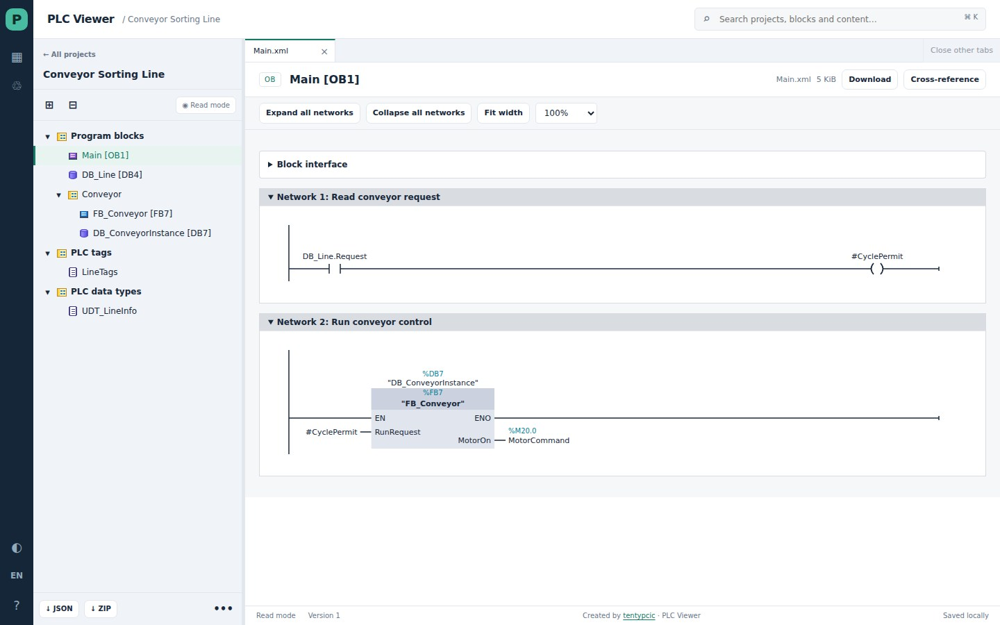

# PLC Viewer

<p align="center"></p>
<p align="center">Local PLC documentation, built with <strong>TypeScript, Vite, IndexedDB and PDF.js</strong>.<br><a href="https://tentypcic.github.io/plc_program_viewer_cms/">Open the app · GitHub Pages</a> · <a href="https://github.com/tentypcic/plc_program_viewer_cms/issues">Report Bug</a></p>

## 🧠 About The Project

**PLC Viewer** develops PLC Programme Viewer CMS into a local library for Siemens TIA Portal documentation. Organize blocks and groups, read PDF/SCL, search documents and keep portable ZIP backups. The interface supports Polish and English.

No backend, accounts or project uploads. User documentation stays in browser IndexedDB. The version 2 modernization is now included in `main`.

## 🛠 Features

- Project catalog, descriptions, pinning, duplication, trash and restore.
- Groups/subgroups, explicit OB / FB / FC / DB / UDT / TAGS / OTHER types and F-block labels.
- Virtualized tree, context menus, document tabs, movable nodes and a resizable workspace.
- Read/edit modes, light/dark themes and a remembered last view.
- Multiple local PDFs/text files per block, notes, alarms, remedies and sequence information.
- PDF.js pages/zoom and text indexing for search; indexing is not OCR.
- SCL lexical highlighting, text comparison and project comparison by UUID.
- Global search, legacy JSON migration, schema-v2 JSON and portable ZIP with local attachments.
- Transactions, revision checks, cross-tab conflict messages and up to 20 earlier project snapshots.

AST analysis, semantic references, dependency graphs and syntax folding have contracts, not working language-analysis implementations. Direct TIA `.ap*` / `.zap*` import is unsupported. See [architecture](docs/ARCHITECTURE_PL.md).

## 🚀 Getting Started

Requires Node.js 22.18+ or Node.js 24.

```sh
npm ci
npm run dev
```

Open the HTTP URL printed by Vite. Do not double-click source HTML. The production build is `dist/`:

```sh
npm test
npm run build
npx playwright install --with-deps chromium
npm run test:e2e
```

## 💾 Data and Recovery

Before upgrading, export `projects.json` from the old viewer. Migration reads `ppv.projects` or `menuData`, preserves original localStorage keys, and stores a raw backup and migration marker transactionally.

Use **ZIP backup** for portable copies: JSON contains structure/text, not local PDF bytes. History is local and is removed with site data. Different domains, including GitHub Pages and Sites, have independent databases; move your documentation with an exported backup.

## 🧪 Verification

**23 tests** and the TypeScript/production build passed on 1 November 2026. Coverage includes migration, ZIP paths/attachments, schema validation, concurrent writes, rollback, history and UUID creation on HTTP hosts without `crypto.randomUUID`.

The E2E suite targets the production build under `/plc_program_viewer_cms/`. Its existence is not evidence of a successful run. Chromium UI checks include creating and reopening a project; other browsers and actual large PDF collections need separate checks.

## ⚠️ Limits

- JSON/ZIP: 100 MiB input; ZIP: 250 MiB expanded. PDF: 50 MiB. Text: 2 MiB and 2 million characters; UTF-8 or BOM-marked UTF-16.
- Up to 2,000 projects per import, 20,000 nodes/documents per project and 64 tree levels; legacy depth is 32.
- Available browser storage varies. Remote PDFs may require CORS; ZIP retains their URL rather than downloading them silently.
- No cloud sync, service worker or guaranteed offline reload. Export independent backups.
- Published on GitHub Pages. Application data stays in the current browser; export a ZIP backup before moving from another domain.

## 📂 Documentation

[User guide](docs/USER_GUIDE_PL.md) · [Data schema](docs/SCHEMA_V2_PL.md) · [Architecture](docs/ARCHITECTURE_PL.md) · [Release notes](docs/RELEASE_V2_PL.md)

The detailed guides remain in Polish. Future import/analysis work must distinguish parsed, resolved and executable support.

## 🧑‍💻 Author and License

Created by [tentypcic](https://github.com/tentypcic). Distributed under the [MIT License](LICENSE).

