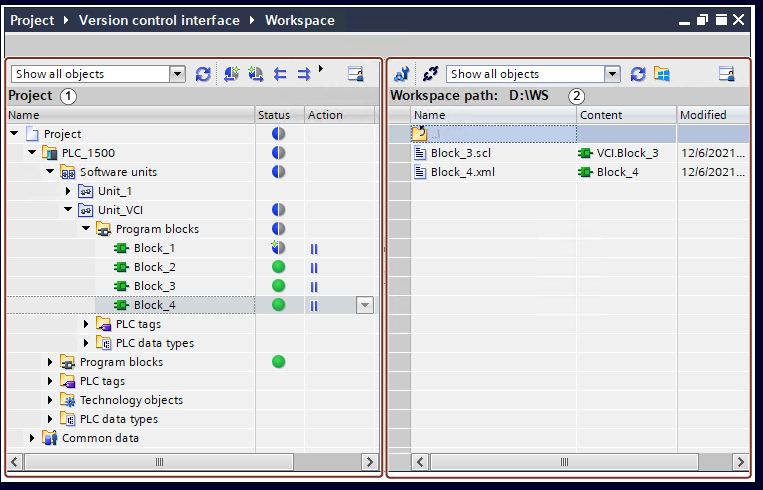

# PLC Viewer for Siemens TIA Portal

<p align="center"></p>
<p align="center">A browser-based project viewer for Siemens TIA Portal. Export your PLC project with VCI, import one XML/SCL ZIP and browse the project tree.<br><a href="https://tentypcic.github.io/plc_program_viewer_cms/">Open the app</a> · <a href="https://tentypcic.github.io/plc_program_viewer_cms/?demo=1&amp;lang=en">Try the demo</a> · <a href="https://github.com/tentypcic/plc_program_viewer_cms/issues">Report Bug</a></p>

## About

**PLC Viewer** opens the exported software of a Siemens PLC in your browser. Import a ZIP of the project's VCI export and browse its folder hierarchy, program blocks (OB, FC, FB and DB), PLC tag tables and data types (UDT). The tree reflects the folders and files included in the ZIP.

The app runs on GitHub Pages and processes imports locally. Projects are saved in the current browser with IndexedDB.

## Export XML from TIA Portal via VCI

Export the software of one PLC to a local folder using the **Version Control Interface (VCI)** in TIA Portal. Import the resulting folder structure into PLC Viewer as a single ZIP.

1. In the TIA Portal **Project view**, expand **Version control interface** and double-click **Add new workspace**. Open the workspace, choose **Configure workspace** and point it to an empty local folder. [Siemens workspace setup](https://docs.tia.siemens.cloud/r/en-us/v20/using-tia-portal-version-control-interface/creating-and-configuring-a-workspace/configuring-workspaces)
2. Under **Options → Settings → Version Control Interface → Export**, use **XML** for block and data exports where a format can be selected. SCL blocks can also be exported as **.scl** source files. In V20 Update 3 or later, check **Configure workspace → Export Format** for workspace-specific settings. [Siemens export format settings](https://docs.tia.siemens.cloud/r/en-us/v20/using-tia-portal-version-control-interface/settings-for-the-version-control-interface/setting-the-export-format/changing-the-export-format)
3. In the workspace editor, drag the selected PLC from **Project** to **Workspace**. To export individual sections, drag **Program blocks**, **PLC tags** and **PLC data types** separately. Confirm compilation if prompted. For a subsequent export, select **Export changes to workspace**, then **Synchronize**. [Siemens export instructions](https://docs.tia.siemens.cloud/r/en-us/v20/using-tia-portal-version-control-interface/synchronization-of-the-workspace-with-the-project/exporting-and-importing-objects) · [Synchronization](https://docs.tia.siemens.cloud/r/en-us/v20/using-tia-portal-version-control-interface/synchronization-of-the-workspace-with-the-project/synchronizing-objects)
4. In Windows Explorer, ZIP the exported PLC folders with their `.xml` and `.scl` files. Keep the subfolders so the Viewer can rebuild the tree. Open PLC Viewer, click **Import**, and select the ZIP. Open the new project and select a block in the tree.



*TIA Portal VCI editor with the Project and Workspace panes. [Siemens documentation](https://docs.tia.siemens.cloud/r/en-us/v20/using-tia-portal-version-control-interface/user-interface-of-the-version-control-interface/overview-of-the-workspace-editor).*

## Demo

**Conveyor Sorting Line** is a synthetic example with an OB, an FB and its instance DB, a global DB, a UDT and a PLC tag table. **Try the demo** opens `Main [OB1]` directly. Double-click `FB_Conveyor` to follow the call, or click `#CyclePermit` to find its read and write references.

The [demo XML files](demo) are authored for this viewer. The example is verified in PLC Viewer.

## 🛠 Features

- Expand project groups and open multiple blocks in tabs.
- Browse supported LAD networks, block interfaces, data blocks and PLC tag tables. Read SCL sources with syntax highlighting.
- Follow block calls and open cross-references from variables in supported networks.
- Search the project, attach PDF and text documentation, and switch between Polish and English or light and dark themes.

## 💾 Export and backup

- **XML/SCL ZIP** downloads the source files in their project folders.
- **ZIP backup** saves the Viewer project with its metadata and local attachments. Import that ZIP to restore the project in another browser.
- **JSON export** saves the project structure and text. Use ZIP backup to include local PDF files.

## Import scope and limits

- Import the PLC software exported through VCI as XML/SCL. TIA Portal project and archive files (`.ap*` and `.zap*`) must be opened in TIA Portal for export first.
- ZIP input is limited to 100 MiB and 250 MiB after extraction.
- Browser storage is specific to the site and browser profile. Keep a ZIP backup before clearing site data or switching profiles.

## 🚀 Run locally

Requires Node.js 22.18+ or Node.js 24.

```sh
npm ci
npm run dev
```

Open the HTTP URL printed by Vite. To build and test the app:

```sh
npm test
npm run build
npx playwright install --with-deps chromium
npm run test:e2e
npm run test:tia
```

## 📂 Documentation

[User guide](docs/USER_GUIDE_PL.md) · [Data schema](docs/SCHEMA_V2_PL.md) · [Architecture](docs/ARCHITECTURE_PL.md) · [Release notes](docs/RELEASE_V2_PL.md)

The detailed guides are in Polish. See [TIA preview scope](docs/TIA_XML.md) for supported objects and instructions.

## 🧑‍💻 Author and License

Created by [tentypcic](https://github.com/tentypcic). Distributed under the [MIT License](LICENSE).

